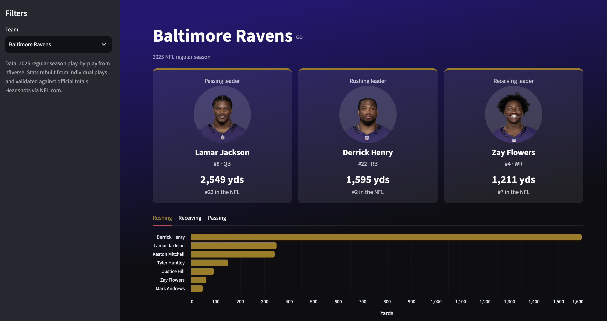

# NFL Data Pipeline

An end-to-end data pipeline that turns raw NFL play-by-play data into player stats and an interactive dashboard, with a focus on the Baltimore Ravens.



## What it does

1. **Extract:** downloads 2025 and 2026 play-by-play data (~48,000 plays per season, 372 columns) from [nflverse](https://github.com/nflverse/nflverse-data)
2. **Transform:** cleans the data and builds passing, rushing, and receiving stats for every player using pandas
3. **Load:** stores the stats in a SQLite database
4. **Analyze:** answers questions with SQL queries
5. **Visualize:** Streamlit dashboard with a team selector, charts, and stat tables

## Validation

Player stats are rebuilt from individual plays and match official nflverse season totals exactly (e.g., Derrick Henry: 307 carries, 1,595 yards, 16 TDs). This required handling official scoring rules: sacks are excluded from pass attempts, QB kneels count as carries, and spikes count as pass attempts.

## Tech stack

Python, pandas, SQLite, SQL, Streamlit, Altair

## How to run it

```bash
python3 -m venv .venv
source .venv/bin/activate
pip install -r requirements.txt

python3 src/download_data.py
python3 src/transform.py
python3 src/load.py
streamlit run src/dashboard.py
```